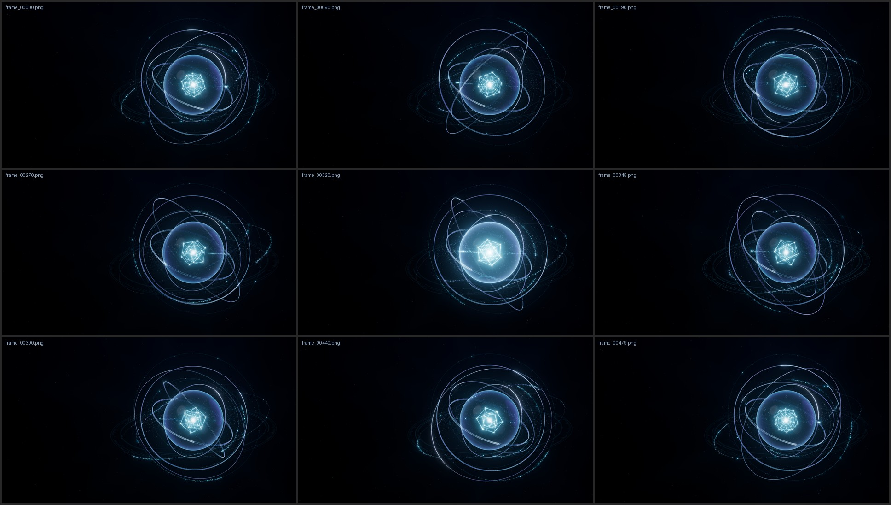

# Holographic AI Core — Quantum Intelligence Interface

Procedural Three.js / WebGL motion graphics for stock-footage production: an
optical-glass sphere holding a luminous geometric nucleus, with independently
animated glass rings, fine orbital paths, an instanced particle field, scan waves,
a soft energy pulse and restrained volumetric light, all on a deep midnight-navy
ground with clean negative space for copy.

Everything is code: no textures, models or third-party assets. The page renders
deterministically from a time value. A headless exporter writes a lossless PNG
sequence, and ffmpeg encodes it. No screen recording is involved anywhere.

## Deliverables

| File (in `output/video/`) | Purpose |
| --- | --- |
| `holographic-ai-core_story_3840x2160_h264.mp4` | **Story cut**, 16 s. Opens from darkness and follows the 5-scene storyboard. Not a loop. |
| `holographic-ai-core_loop_3840x2160_h264.mp4` | **Seamless loop**, 16 s. A periodic system that repeats with no seam. |
| `*_preview-1080p-from-2160p_h264.mp4` | 1080p previews, *downscaled* from the native 4K frames. |
| `output/<name>/frames/frame_00000.png …` | Lossless 8-bit RGB PNG image sequences (the true masters). |
| `*_prores422hq.mov` (optional, `--prores`) | Editing mezzanine, 10-bit 4:2:2. |

The story's state at t = 16 s is **exactly** the loop's state at t = 0. The QC
proves this pixel for pixel. An editor can therefore cut *story → loop → loop → …*
for any length of hero hold with no seam.

Why two files? A story that rises out of darkness cannot also be periodic,
because its first frame is black. Instead of hiding a discontinuity with a cut, the
loop is built as a periodic system from the start, and the story is that same
system with a build-up overlay and an intro camera move that both resolve to zero
before the end.

### Storyboard (story cut)

| Time | Scene | What happens |
| --- | --- | --- |
| 0–3 s | Digital Awakening | A few cyan motes emerge from darkness and drift inward along the orbital paths, which draw on. The first glass ring materialises around its circumference. |
| 3–6 s | Core Formation | The sphere materialises with a rising sweep. The inner dodecahedron, then the outer icosahedron, draw on edge by edge. The remaining rings swing in and settle (critically damped). |
| 6–10 s | Holographic Expansion | Three scan waves cross the sphere. Inner sparks orbit the nucleus and iridescence flows over the glass. The camera dollies in slowly. |
| 10–13 s | Intelligent Energy Field | The core charges, then releases a soft pulse. Rings expand and contract outward in sequence, particles are pushed and brightened as the wavefront passes, and the haze lights up. |
| 13–16 s | Premium Hero | The camera settles onto the hero framing and the lighting peaks (around 14.6 s). |

The loop contains the same scans, pulse, ring breathing and lighting peak at the
same times. Only the build-up and intro camera move are story-specific.

## Quick start

```bash
cd examples/holographic-ai-core
npm install                 # three@0.170.0 + playwright@1.56.1
npm run preview             # http://localhost:5173/
```

The preview page has play/scrub, a mode switch (loop/story), a preset menu and a
**Guides** overlay showing thirds, action and title safe areas, and the copy-space
zone. The overlay is HTML on top of the canvas and is never rendered into frames.
Any parameter can go in the URL, e.g.
`http://localhost:5173/?mode=story&preset=violet-shift&w=1920&h=1080`.

## Rendering and export

```bash
npm run build:preview       # 1280x720, about 15 min on a 4-core CPU (software WebGL)
npm run build:4k            # native 3840x2160 masters + 1080p previews + QC
```

`build-all.sh` renders both cuts, encodes them, runs QC and writes contact sheets
to `output/qc/`. Rendered frames are kept: an interrupted run resumes where it
stopped (frames are written atomically), and `--force` re-renders.

The individual steps:

```bash
# PNG image sequence (frame i is rendered at t = i / fps; order and speed don't matter)
node scripts/render.mjs --mode loop --width 3840 --height 2160 --workers 3 --extra
node scripts/render.mjs --mode story --frames 0,240,479            # stills only
node scripts/render.mjs --mode loop --preset violet-shift --param seed=11

# Encode (refuses to run if any frame is missing)
node scripts/encode.mjs --mode loop --preview          # H.264 4K master + 1080p preview
node scripts/encode.mjs --mode loop --prores           # + ProRes 422 HQ

# QC
python3 scripts/qc.py --frames output/holographic-ai-core_loop_3840x2160/frames \
  --video output/video/holographic-ai-core_loop_3840x2160_h264.mp4 --loop --expect-size 3840x2160
```

H.264 settings: High profile, level 5.1, yuv420p, CRF 14, `preset slow`, adaptive
quantisation tuned for dark gradients (`aq-mode=3`), a 1-second GOP (keyframe every
30 frames, scene-cut off), BT.709 tags, `+faststart` and no audio. 1080p previews
use CRF 18.

**Render cost (measured in this environment):** headless Chromium with SwiftShader
(CPU WebGL, 4 cores) took about 10 s per 4K frame per worker, or 3.6–3.9 s per frame
with 3 parallel workers. That is about 30 min per 16 s cut. A machine with a
GPU-backed browser will be far faster, and the exporter is the same either way. On a
GPU machine you can drop the SwiftShader flags in `render.mjs`.

### Reference render (default preset, seed 7)

| Cut | Size | Codec | Frames / fps / duration | Bitrate | File |
| --- | --- | --- | --- | --- | --- |
| Loop | 3840×2160 native | H.264 High@5.1, yuv420p, BT.709 | 480 / 30 / 16.0 s | 45.5 Mb/s | 91.1 MB |
| Story | 3840×2160 native | H.264 High@5.1, yuv420p, BT.709 | 480 / 30 / 16.0 s | 39.8 Mb/s | 79.6 MB |

Both cuts are progressive with no audio stream, and every `qc.py` check passed. The
loop's frame 480 and the story's frame 480 are both pixel-identical to loop frame 0.
The JSON reports and contact sheets are in [`docs/`](docs).



Video files are not committed. Regenerate them with `npm run build:4k`.

## Project structure

```
index.html              preview page (importmap -> node_modules/three)
src/
  main.js               preview UI + headless API (window.HOLO.render/capture/check)
  world.js              renderer, camera, post chain, per-frame update
  timeline.js           deterministic choreography: computeState(t, cfg)
  config.js             defaults, presets, URL/CLI parameter parsing
  rng.js                seeded PRNG (mulberry32)
  palette.js            sRGB palette -> linear, global hue rotation
  shaders/common.js     shared GLSL: pulse field, glass transmission, thin film, softboxes
  background.js         navy gradient, volumetric scatter, light shafts, vignette
  glassCore.js          glass shell + instanced nucleus (icosahedron + dual dodecahedron) + halos
  rings.js              superellipse-profile glass rings with metallic rims and etched ticks
  orbits.js             hair-thin orbital paths with travelling comets
  particles.js          ~3,200 particles in one Points draw call, positions computed on the GPU
  interfacePlane.js     faint calibrated "lens" interface plane
  finishPass.js         exposure, ACES filmic, sRGB, static dither
scripts/
  serve.mjs             static server   render.mjs   PNG-sequence exporter
  encode.mjs            ffmpeg encoder  qc.py        automated QC
  build-all.sh          full pipeline   contact_sheet.py
QC_CHECKLIST.md         automated + manual QC checklist
```

## How the look is built

- **Order-independent transparency.** Every holographic layer uses additive
  blending with no depth writes. Addition is commutative, so transparency sorting
  cannot break or pop. Glass occlusion is analytic instead: a ray–sphere test in
  each shader dims and tints whatever is seen *through* the sphere.
- **Glass.** The inner and outer surfaces are drawn separately. Each has Fresnel
  weighting, palette-constrained thin-film iridescence that flows slowly over the
  surface, two procedural softbox reflections (a silver key and a violet rim), and a
  faint latitude graticule.
- **Rings.** Each ring is a lathe of a superellipse cross-section with analytic
  normals, giving crisp metallic rims, a glassy band and etched graduations. Each
  ring spins, precesses and breathes independently.
- **Light.** Everything is rendered linear into a half-float MSAA ×4 target. Bloom
  is restrained (strength 0.5, threshold 0.62). The finish pass applies ACES filmic
  and sRGB, plus a *static* triangular dither that suppresses 8-bit banding in the
  navy gradients without adding temporal noise.
- **Anti-aliasing.** 4× MSAA on the HDR target. Fine procedural patterns fade out
  via `fwidth` before they can alias. Particle sprites never go below about 1.3 px
  (at 1080p-equivalent), with energy-conserving alpha, so sub-pixel points don't
  twinkle.
- **Composition.** A lens shift (`camera.filmOffset`) rather than a pan places the
  core on the right third with no perspective skew, leaving about 40 % of the frame
  as clean negative space.

## Determinism and the seamless loop

- Every animated value is a pure function of `t`. Nothing accumulates between
  frames and nothing reads a clock, so any frame can be rendered in any order or in
  parallel.
- All randomness (particles, edge timings) comes from a seeded PRNG, and the same
  seed produces identical output.
- Periodicity is built in. Each rotation is a **whole number of turns per loop**
  plus periodic sine easing, which gives speed variation and "physically plausible"
  easing while staying C∞-periodic. One-off events (scans, the pulse, ring
  expansion) are windowed bumps that start and end inside the loop. The camera
  drift and the lighting peak are periodic functions. QC verifies that frame 480
  (t = T) equals frame 0 and that the last → first step is an ordinary motion step.

## Parameters

Pass these as URL params in the preview, or as `--param key=value` (or `--preset`)
to `render.mjs` / `build-all.sh` via `PARAMS="..."`.

| Parameter | Default | Effect |
| --- | --- | --- |
| `seed` | 7 | Particle placement and edge timing |
| `loopDuration` | 16 | Loop length in seconds (story beats scale with it). Also pass `--duration` to the scripts. |
| `ringSpeed` | 1 | Integer multiplier on ring turns per loop |
| `ringEasing` | 1 | Amplitude of the rings' periodic speed variation |
| `coreRotation` | 1 | Integer nucleus turns per loop |
| `particleCount` | 1 | Multiplier on the ~3,200-particle budget |
| `particleSpeed` | 1 | Integer multiplier on orbital particle and comet turns per loop |
| `particleDrift` | 1 | Amplitude of particle bob and ambient dust drift |
| `glowIntensity` | 1 | Bloom strength and core halos |
| `exposure` | 1 | Linear exposure before tone mapping |
| `hue` | 0 | Hue rotation of the whole holographic palette (degrees) |
| `cameraMotion` | 1 | Amplitude of the loop camera drift and the story dolly |
| `cameraAzimuth` / `cameraElevation` | 18 / 9 | Hero camera angle (degrees) |
| `framing` | 1 | Above 1 pulls back (more negative space), below 1 moves closer |
| `composition` | `right` | `right`, `left` or `center` placement of the core |
| `backgroundDarkness` | 0.6 | 0 = lifted navy, 1 = near black |
| `pulseStrength` | 1 | Energy pulse and ring breathing amplitude |
| `ringCount` | 5 | 1–6 rings |

Integer-valued speeds are what make the loop exact. A non-integer value is rounded
and reported as a config warning rather than silently breaking the loop.

### Presets for genuinely different compositions

| Preset | Result |
| --- | --- |
| `default` | Core on the right third, copy space on the left |
| `hero-left` | Mirrored framing: core left, copy right |
| `centered-wide` | Centred, pulled back, higher angle; works as a background plate |
| `macro-close` | Close, low, three-quarter angle; the nucleus fills the frame |
| `violet-shift` | Palette rotated toward violet, core on the left |
| `ice-minimal` | Three rings, fewer particles, darker ground; quiet and corporate |
| `energetic` | Double ring, particle and core speeds, stronger pulse |

Combine presets with `seed` and `hue` for further variations, e.g.
`PARAMS="--preset hero-left --param hue=-20 --param seed=23" bash scripts/build-all.sh`.

## Content policy

No text, numerals, logos, watermarks, brand marks, characters or recognisable
third-party UI are rendered. The ring and interface graduations are plain geometric
ticks. There is no audio.

## Known limitations

- There is no motion blur: each frame is an instantaneous sample. Motion is slow
  enough that this reads as crisp rather than strobing. Temporal supersampling
  (averaging sub-frames) would be the natural extension, at N× render cost.
- The H.264 deliverable is 8-bit 4:2:0, and the static dither in the finish pass
  is there to hold the dark gradients. For grading, use the PNG sequence or ProRes.
